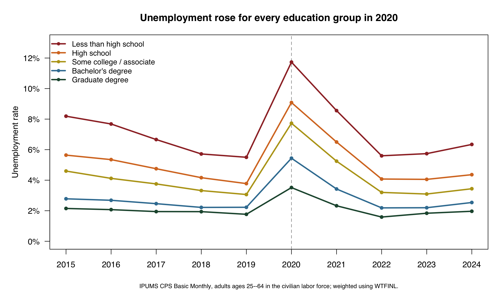
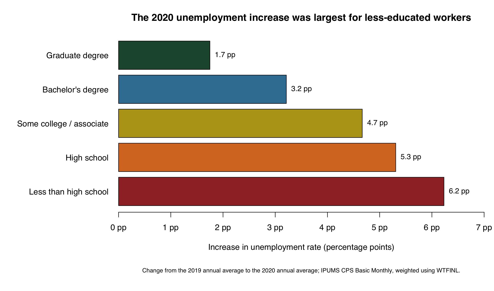
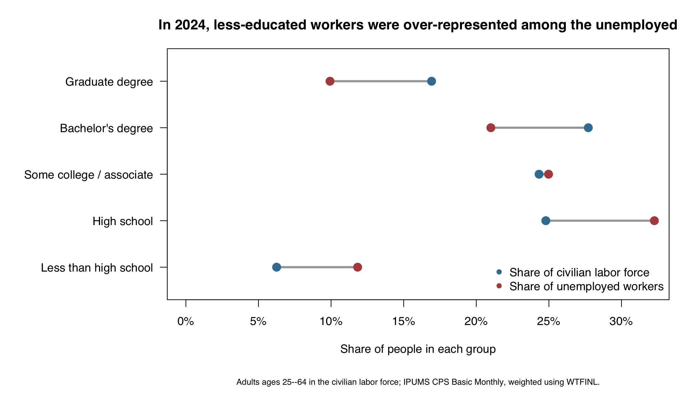

 # Education and Unemployment: Who Bore the COVID-19 Labor-Market Shock?

Did education protect U.S. workers from unemployment during the COVID-19 recession, and did that protection persist after the labor market recovered? I use IPUMS Current Population Survey (CPS) Basic Monthly data from 2015 through 2024 to examine this question. The CPS is a monthly survey of the U.S. population. I restrict the analysis to adults ages 25--64 who are in the civilian labor force: people who were employed or unemployed and looking for work.

The outcome is the unemployment rate, defined as the weighted number of unemployed people divided by the weighted civilian labor force. I classify educational attainment into five groups: less than high school, high school, some college or an associate degree, a bachelor's degree, and a graduate degree. The extract contains all twelve Basic Monthly samples for each year. I pool the monthly interviews within each calendar year, so the results should be interpreted as weighted annual averages of monthly labor-market conditions, rather than as estimates from one annual interview.

Every estimate uses the CPS final Basic Monthly person weight, `WTFINL`. This matters because a raw survey count would describe only the people interviewed. Applying the sampling weight produces estimates intended to represent the U.S. civilian population covered by the CPS. IPUMS specifies `WTFINL` as the appropriate person-level weight for Basic Monthly analyses.

```r
# Core calculation: unemployment / civilian labor force
analysis <- cps[cps$AGE >= 25 & cps$AGE <= 64 &
                cps$EMPSTAT %in% c(10, 12, 21, 22), ]
analysis$unemployed_weight <- analysis$WTFINL *
                              (analysis$EMPSTAT %in% c(21, 22))

annual <- aggregate(cbind(labor_force_population = WTFINL,
                          unemployed_weight) ~ YEAR + education,
                    data = analysis, FUN = sum)
annual$unemployment_rate <- annual$unemployed_weight /
                            annual$labor_force_population
```

## Long-run pattern: unemployment was lower at higher education levels

Even before the pandemic, unemployment was systematically higher among adults with less education. In 2019, the weighted unemployment rate was 5.5% for adults without a high-school credential, compared with 1.8% for adults with graduate degrees. Figure 1 shows that this difference did not emerge only during the pandemic. It was visible throughout the pre-2020 period.



## The COVID-19 shock was not equally large

The COVID-19 shock made the gap much larger. Figure 2 changes the question from *who had the highest unemployment rate?* to *who experienced the largest increase?* From 2019 to 2020, the weighted unemployment rate rose by 6.2 percentage points for adults without a high-school credential, compared with 1.7 percentage points for graduate-degree holders. Every group experienced a substantial increase, but the initial shock was clearly more severe for workers with less education.



By 2024, unemployment had fallen sharply across the distribution. However, recovery did not erase the gradient. The 2024 rate remained 6.3% for the less-than-high-school group, compared with 2.0% for graduate-degree holders. The difference was smaller than during the acute pandemic shock but still economically meaningful.

## Who was over-represented among unemployed workers in 2024?

The third figure provides a different population-level perspective. It compares each education group's share of the 2024 civilian labor force with its share of all unemployed workers. A group appearing farther right in red than in blue is over-represented among unemployed workers. Adults without a high-school credential made up a noticeably larger share of the unemployed population than of the labor force. In contrast, adults with bachelor's or graduate degrees accounted for smaller shares of unemployed workers than of the labor force. This composition comparison reinforces the rate evidence without merely repeating it: the education gap affected the make-up of unemployment as well as each group's risk of unemployment.



## Takeaway

Education did not make workers immune to the COVID-19 recession, but it was strongly associated with lower unemployment before, during, and after it. The pandemic amplified a pre-existing gap, and the recovery narrowed that gap without eliminating it. These findings are descriptive, not causal: education is connected to occupation, industry, work experience, and other factors that also affect job loss. Yet the weighted CPS evidence clearly identifies workers with less formal education as the group facing the greatest unemployment risk during this period.

**Data and reproducibility.** The data are from [IPUMS CPS](https://cps.ipums.org/), Basic Monthly samples, 2015--2024. The accompanying `blogpost3_cps_csv.R` script imports the extract, applies `WTFINL`, creates the summary tables, and calls `make_figures.R` to reproduce all figures. IPUMS documents the Basic Monthly weight [here](https://cps.ipums.org/cps-action/variables/WTFINL).
