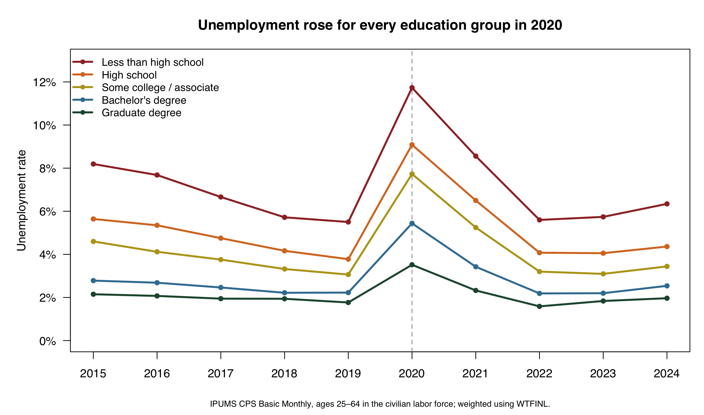
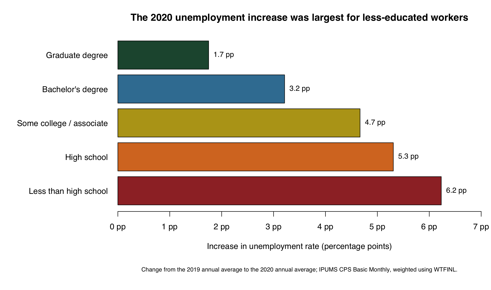
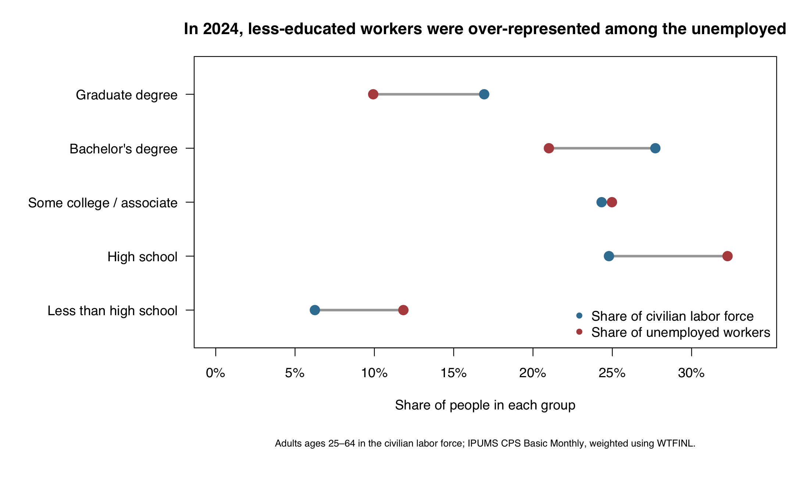

## The question

Did education protect U.S. workers from unemployment during the COVID-19 recession, and did that protection persist after the labor market recovered? This post uses IPUMS Current Population Survey (CPS) Basic Monthly data from 2015 through 2024 to examine unemployment among adults ages 25–64 in the civilian labor force.

## Data and methods

The unemployment rate is the weighted number of unemployed people divided by the weighted civilian labor force. I group educational attainment into less than high school, high school, some college or an associate degree, a bachelor's degree, and a graduate degree. The analysis pools all twelve Basic Monthly samples within each year, so the estimates are weighted annual averages of monthly labor-market conditions.

Every estimate uses the CPS Final Basic Monthly person weight, `WTFINL`. Weighting is necessary because the CPS interviews only a sample of U.S. residents. The results therefore describe the population covered by the CPS rather than just the survey respondents.

## Long-run pattern: unemployment was lower at higher education levels

Even before the pandemic, unemployment was systematically higher among adults with less education. In 2019, the weighted unemployment rate was 5.5% for adults without a high-school credential, compared with 1.8% for adults with graduate degrees. Figure 1 shows that this education gap existed throughout the pre-2020 period.

## The COVID-19 shock was not equally large

Figure 2 asks a different question: who experienced the largest increase in unemployment? From 2019 to 2020, the unemployment rate increased by 6.2 percentage points for adults without a high-school credential, compared with 1.7 percentage points for graduate-degree holders. Every education group was affected, but the initial shock was much more severe for workers with less education.

By 2024, unemployment had fallen sharply across the distribution. Recovery did not erase the gradient: the 2024 rate remained 6.3% for the less-than-high-school group, compared with 2.0% for graduate-degree holders.

## Who was over-represented among unemployed workers in 2024?

The final figure compares each education group's share of the 2024 civilian labor force with its share of all unemployed workers. A group whose red point lies farther right than its blue point is over-represented among unemployed workers. Adults without a high-school credential and adults with only a high-school credential made up larger shares of unemployed workers than of the civilian labor force. Adults with bachelor's or graduate degrees showed the opposite pattern.

## Limitations and takeaway

Education did not make workers immune to the COVID-19 recession, but it was strongly associated with lower unemployment before, during, and after the shock. These results are descriptive, not causal: education is related to occupation, industry, work experience, and other factors that also affect job loss. Still, the weighted CPS evidence identifies less-educated workers as facing both a larger initial increase in unemployment and disproportionate representation among unemployed workers in 2024.

## Data sources and reproducible code

The data are from [IPUMS CPS](https://cps.ipums.org/), Basic Monthly samples, 2015–2024. `blogpost3_cps_csv.R` documents how to calculate the weighted estimates from the IPUMS extract. `make_figures.R` creates every figure from the saved result tables in `results/`. IPUMS documents the Basic Monthly weight [WTFINL here](https://cps.ipums.org/cps-action/variables/WTFINL).
