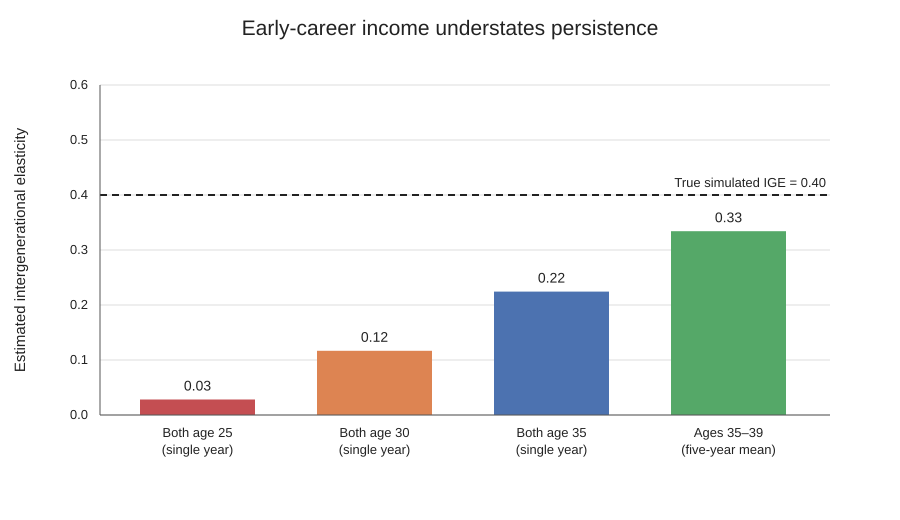
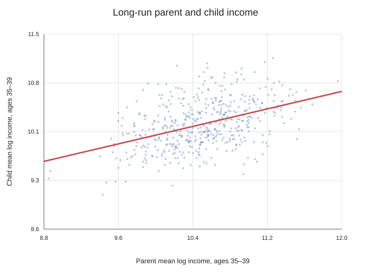

## Why match two generations?

The intergenerational income elasticity (IGE) summarizes how strongly economic status persists from parents to children. In a log–log regression, an IGE of 0.4 means that a 1% difference in parental income is associated with about a 0.4% difference in children’s income, on average. Estimating it requires more than a regression: we first need to link each child to the right parent and decide how to measure income over the life cycle.

This tutorial uses Python’s built-in SQLite database to make that workflow concrete. The included panel is simulated, not real survey data. Its long-run IGE is set to 0.40, while annual income contains temporary shocks that are larger early in adulthood. The simulation lets us see how an unreliable single-year measure can understate persistence.

## Identifiers and the match

The project has two tables. `family_members` records each `person_id`, the person’s `family_id`, and whether they are a parent or child. `income` stores repeated person-year observations. A stable person identifier links annual records to the roster; the shared family identifier links the two generations.

The Python script creates the SQLite tables, registers logarithm functions, and runs `sql/parent_child_ige.sql`. In SQL, `SELECT` chooses the fields and calculations to return. `JOIN` connects income observations to each person and then connects the parent summary to the child summary using `family_id`. `WHERE` separates parents from children. `GROUP BY` reduces many annual records to one summary row per person and family. `AVG(CASE WHEN...)` selects a year or age window and aggregates it. For example:

```sql
SELECT fm.family_id, fm.person_id,
       AVG(CASE WHEN i.age BETWEEN 35 AND 39
                THEN LOG(i.annual_income) END) AS mean_log_income
FROM family_members AS fm
JOIN income AS i ON i.person_id = fm.person_id
WHERE fm.role = 'parent'
GROUP BY fm.family_id, fm.person_id;
```

The full query applies the same logic to each generation and joins the two resulting summaries. The regression uses average log income, equivalent to the log of geometric mean income. In real data, the age window, income definition, weights, and treatment of missing or nonpositive income should follow the dataset documentation and research question.

## What changes when we average income?

The script estimates four log–log OLS regressions on 5,000 matched families. The first three compare parent and child income at the same single age. The fourth uses five-year averages for both generations at ages 35–39.

| Income measure | Estimated IGE | 95% confidence interval |
|---|---:|---:|
| Single year, both age 25 | 0.028 | [0.001, 0.055] |
| Single year, both age 30 | 0.117 | [0.091, 0.143] |
| Single year, both age 35 | 0.224 | [0.204, 0.245] |
| Five-year mean, both ages 35–39 | 0.334 | [0.314, 0.354] |



The estimates rise as income is measured later in the career and averaged over several years. The one-year measure at age 25 is especially noisy in this simulation, so it ranks families poorly by their longer-run income. That error in the parent-income measure weakens the estimated slope toward zero. Averaging reduces temporary fluctuations and moves the estimate closer to the data-generating IGE of 0.40. The five-year estimate remains below 0.40 because averaging cannot remove all noise or finite-sample variation.



## Takeaway and limits

SQL makes a complicated longitudinal match auditable: identify people, summarize each generation with `GROUP BY`, and join the summaries on a documented family link. Measuring income in one year can confound permanent economic status with temporary earnings shocks. In this example, averaging several years produces an estimate closer to the known long-run relationship.

These numerical findings illustrate a mechanism in simulated data; they are not an empirical estimate for the United States. With survey data, researchers must verify identifier definitions, sample restrictions, age windows, inflation adjustments, and survey weights. The complete code, generated inputs, query, and output files are included in the accompanying project folder.
