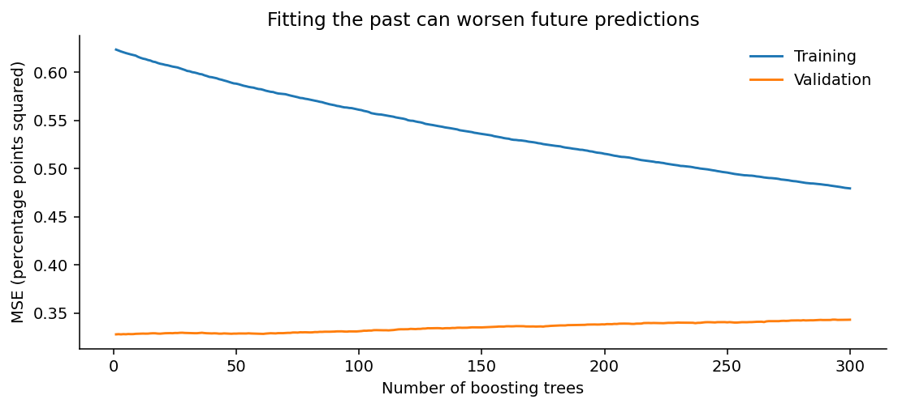
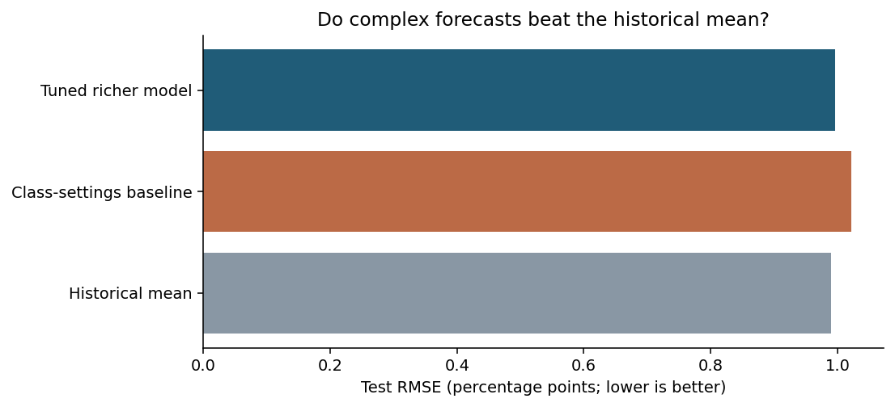
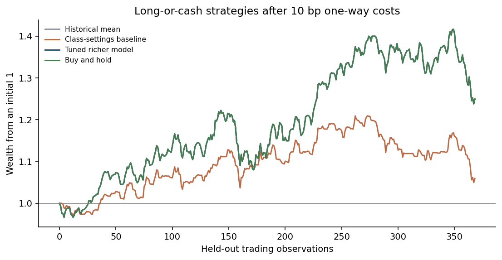

```{r}
#| label: setup
#| include: false
source("scripts/run_analysis.R")
run_post9_analysis()
metrics <- read.csv("results/predictive_metrics.csv")
investment <- read.csv("results/investment_metrics.csv")
class_results <- read.csv("results/class_simulation.csv")
selected <- read.csv("results/validation_search.csv")[1, ]
splits <- read.csv("results/splits.csv")
pct <- function(x) sprintf("%.2f%%", 100 * x)
rmse <- function(i) sprintf("%.3f", 100 * metrics$rmse[i])
```

## What carries over from class?

Can a model that learns nonlinear patterns turn yesterday's information into profitable stock forecasts? Class 21 provides a useful starting point: gradient boosting begins with the training mean, fits a shallow tree to residuals, and repeatedly adds a fraction of that correction:

$$
F_m(x)=F_{m-1}(x)+\eta h_m(x).
$$

The supplied lesson uses 1,200 **simulated** observations with five predictors; only two determine the outcome. Reproducing its 75/25 random split, seed 6400, and scikit-learn model gives test MSE `r sprintf("%.2f", class_results$test_mse[2])`, versus `r sprintf("%.2f", class_results$test_mse[1])` for the training mean. Boosting can recover planted nonlinear structure.

**Scope:** the supplied lesson contains no stock dataset or stock experiment. This post extends its model settings to market data; it does not claim to reproduce an unavailable classroom stock backtest. The “class-settings baseline” below is therefore a new application of the lesson's algorithm.

## A harder, real-data question

I predict FTSE index returns using R's `EuStockMarkets`: 1,860 business-time observations of four European indices from 1991–1998, supplied by Erste Bank. This is a historical stock-index exercise, not a current-market forecast. The file has observation order rather than exact daily dates.

The baseline uses five recent FTSE returns and the lesson's settings: 300 trees, learning rate 0.05, depth 2, and minimum leaf size 5. The proposed improvement adds 5- and 20-observation momentum and volatility for all four markets, plus other markets' latest returns. These variables might capture persistent trends, changing risk, and shared market conditions.

Information ends at close $t$. To avoid assuming an immediate trade at that same close, execution is delayed to close $t+1$, and the target is:

$$
y_t=\frac{P_{t+2}}{P_{t+1}}-1.
$$

I divide usable rows chronologically into approximately 60% training, 20% validation, and 20% test. Two rows are purged before each later block so earlier labels cannot overlap its information dates. Sixteen conservative configurations vary tree count, learning rate, depth, and leaf size. Validation MSE selects the model; test outcomes never select features, settings, or trading rules. Both boosting models are then refitted on the same pre-test data.

```{r}
#| label: split-table
knitr::kable(splits, col.names = c("Stage", "Rows", "First feature obs.", "Last feature obs.", "Last target obs."))
```

## Does the improvement work?

Validation selects `r selected$n_estimators` trees, learning rate `r selected$learning_rate`, depth `r selected$max_depth`, and leaf size `r selected$min_samples_leaf`. The learning curve illustrates the danger: improving training fit need not improve future performance.

```{r}
#| label: fig-learning
#| fig-cap: "Class-settings model fitted only on the training block. Validation errors are evaluated separately; neither line uses the test block."

```

On `r nrow(read.csv("results/test_predictions.csv"))` held-out observations, baseline RMSE is `r rmse(2)` percentage points; the tuned model reaches `r rmse(3)`. That is an improvement over the original settings, but the historical-mean benchmark achieves `r rmse(1)`. Negative out-of-sample $R^2$, measured against that fixed pre-test mean, means boosting still loses to the simple forecast.

```{r}
#| label: prediction-table
display <- data.frame(Model = metrics$model,
  `RMSE (pp)` = round(100 * metrics$rmse, 3),
  `MAE (pp)` = round(100 * metrics$mae, 3),
  `Direction correct` = pct(metrics$directional_accuracy),
  `R2 vs mean` = round(metrics$r2_vs_historical_mean, 4), check.names = FALSE)
knitr::kable(display)
```

```{r}
#| label: fig-rmse
#| fig-cap: "All forecasts face the same untouched test observations. Lower prediction error is better."

```

Stock returns are difficult because news produces large unpredictable movements, conditional mean signals are weak, and relationships can change. A flexible model can learn historical noise. The simulation guarantees stable signal; market data offer no such guarantee.

## Would the predictions make money?

The fixed rule holds the index when predicted returns are positive and otherwise holds zero-interest cash. Each unit of one-way turnover costs 10 basis points, including entry and final liquidation. Buy-and-hold uses the same entry/exit costs.

```{r}
#| label: investment-table
display <- data.frame(Strategy = investment$strategy,
  `Gross return` = pct(investment$gross_total_return),
  `Net return` = pct(investment$total_return),
  `Max drawdown` = pct(investment$max_drawdown),
  `Time invested` = pct(investment$exposure),
  `One-way turnover` = investment$one_way_turnover, check.names = FALSE)
knitr::kable(display)
```

```{r}
#| label: fig-wealth
#| fig-cap: "Net wealth on the identical held-out period. The historical-mean, tuned-model, and buy-and-hold curves overlap because all remain invested throughout."

```

The baseline earns `r pct(investment$total_return[2])` net, despite `r pct(investment$gross_total_return[2])` gross, because frequent switching is expensive. The tuned model earns `r pct(investment$total_return[3])`, exactly matching buy-and-hold: every test prediction is positive. Its gain reflects market exposure, not successful timing. Similar direction accuracy therefore need not imply similar investment outcomes.

These are illustrative index-return calculations. Indices are not directly tradable; fund tracking, dividends, taxes, actual cash interest, and execution prices are omitted. One old test window cannot establish reliable investment skill.

**Takeaway:** regularization and richer information improve this boosting baseline, yet fail to beat the historical mean in prediction or buy-and-hold economically. A more honest evaluation is a stronger result than a more complicated model.

## Sources and reproducibility

- Yisroel Cahn, *Class 21 — Decision Trees, Random Forests, and Gradient Boosting*, supplied course `.qmd`, sections 3–4 and 50. The simulation is reproduced; the stock application is new.
- [R documentation: EuStockMarkets](https://stat.ethz.ch/R-manual/R-devel/library/datasets/html/EuStockMarkets.html).
- [scikit-learn: GradientBoostingRegressor](https://scikit-learn.org/stable/modules/generated/sklearn.ensemble.GradientBoostingRegressor.html).

All calculations regenerate when this page renders. The repository folder includes raw data, the complete analysis, validation results, individual test forecasts, trading positions, cost sensitivity, and software versions. README.md explains installation and website integration.

```{r}
#| label: full-analysis
#| echo: false
#| results: asis
# Make the complete modeling code inspectable on the published page.
cat("<details><summary>Show the full Python analysis</summary>\n\n")
```

```{r}
#| label: python-source
#| echo: false
#| results: asis
cat("\n```python\n", paste(readLines("scripts/analysis.py"), collapse = "\n"), "\n```\n", sep = "")
```

```{r}
#| echo: false
#| results: asis
cat("\n</details>\n")
```
